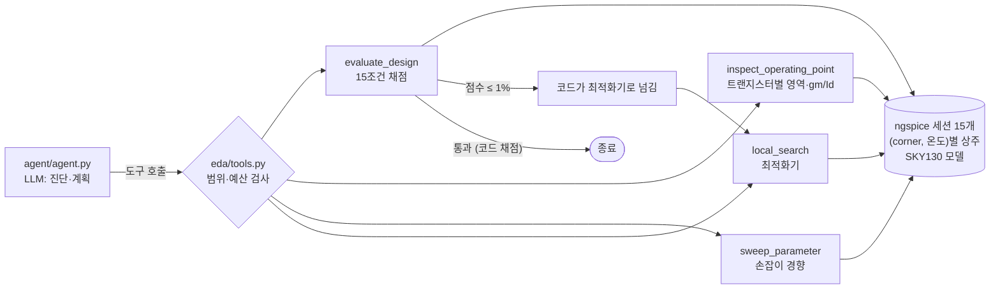

# EDA Sizing Agent

아날로그 회로(5T OTA)의 사이징을 LLM Agent가 EDA 도구를 골라 쓰며 푼다.
공개 PDK(SKY130)와 ngspice로 5 corner × 3 온도 = 15개 조건 전부에서 스펙을 맞추는 문제를 만들고,
Random Search·교과서 규칙과 같은 시작점에서 비교했다.

> **30초 요약**
> - **문제**: 손잡이 7개(bias 전류, W/L 3쌍)로 15개 조건 전부에서 gain ≥ 42dB, UGF ≥ 20MHz, PM ≥ 60°, 전력 ≤ 70µW, 모든 트랜지스터 포화 여유 ≥ 50mV. 무작위 설계 3000개 중 2개만 통과하는 난이도(데이터로 보정, 해가 있음은 확인).
> - **결과 (처음 보는 시작점 10개, 규칙은 실행 전에 커밋)**: Agent **25/30 해결**, 교과서 규칙 3/10, Random Search 2/10(2000회 예산).
> - **역할 분담**: LLM은 진단과 방향(어느 조건·어느 트랜지스터·어느 동작 영역), 숫자 미세 조정은 최적화기, 통과 판정·범위·예산은 코드.
> - **정직한 결과**: 개발 중 효과가 났던 개선(거의 통과하면 최적화기로 넘기기, +18%p)은 held-out에서 해결률 효과가 **재현되지 않았고** LLM 비용 −25%만 남았다. 다른 개선(진단 강제)은 처음부터 효과가 없었다.
> - **과정**: 시뮬레이터 속도 240배 개선부터 효과가 사라진 실험까지 11건을 [문제 해결 기록](docs/troubleshooting_log.md)에 남겼다. 발표용: [docs/highlights.md](docs/highlights.md)

## 왜 이 문제인가

아날로그 사이징은 "시뮬레이션 → 결과 보고 → W/L 조정 → 다시 시뮬레이션"의 반복이다. 어려운 건 TT 한 조건이 아니라
**모든 corner·온도에서 동시에** 버티는 것이고, 스펙 숫자가 멀쩡해도 트랜지스터가 포화 영역을 벗어나 있으면 회로가 건강하지 않다.
교과서 규칙("gain이 부족하면 L을 늘린다")은 전제(강반전, 손잡이에 여유 있음)가 깨지면 멈춘다.
이 프로젝트는 LLM Agent가 **도구를 orchestration하며** 그 빈자리를 채울 수 있는지, 무엇을 LLM에 맡기고 무엇을 코드에 맡겨야 하는지를 측정한다.

## 구조



**설계 원칙** — 대부분 평가에서 실패를 보고 정했다.

1. **도구는 "실행됨"과 "의미 있음"을 구분한다.** bias를 0에 가깝게 하면 ngspice는 오류 없이 "UGF 7Hz, PM 93°"를 낸다. 이런 결과는 측정 무효로 돌려준다. 스펙 숫자만 보지 않고 트랜지스터별 포화 여유를 채점에 넣는다. ([2번](docs/troubleshooting_log.md), [3번](docs/troubleshooting_log.md))
2. **통과는 코드가 판정한다.** Agent가 "됐다"고 말하는 것은 의미가 없고, 채점 결과가 통과하는 순간 시스템이 끝낸다.
3. **범위와 예산은 코드가 막는다.** 손잡이 범위 밖 값, 바꿀 수 없는 값(앞단이 정하는 입력 공통 전압), 예산을 넘는 호출은 실행 전에 거부하고 이유를 돌려준다.
4. **LLM은 방향, 최적화기는 숫자.** 실패의 대부분은 1~2% 부족한 상태에서 LLM이 숫자를 손으로 만지며 단계를 다 쓴 것이었다. 1% 안이면 코드가 최적화기로 넘긴다. ([9번](docs/troubleshooting_log.md), [10번](docs/troubleshooting_log.md))
5. **평가는 실험처럼.** 스펙 난이도는 무작위 설계 3000개로 보정하고 해가 있음을 테스트로 고정했다. 같은 시작점끼리 짝지어 비교, 3회 반복, 시작점 단위 bootstrap CI, held-out 규칙은 실행 전에 커밋. ([6번](docs/troubleshooting_log.md), [11번](docs/troubleshooting_log.md))

## 결과

모델 gpt-5-mini, 시뮬레이션 예산 2000회, LLM 호출 최대 40번. 시뮬레이션 1회 = 조건 하나.

### held-out (시드 5000~5009, 개발 중 한 번도 안 돌림, 결과를 보고 고치지 않음)

| 방법 | 해결 | 해결 시 시뮬레이션 중앙값 | LLM 호출 중앙값 | 실행당 비용 |
|---|---|---|---|---|
| Random Search (seed 10개, 시작점 무관) | 2/10 | 494, 1497 (해결한 2개) | - | $0 |
| 교과서 규칙 (결정적, 1회) | 3/10 | 240~420 | - | $0 |
| Agent | **25/30** | 411 | 31.5 | $0.12 |
| Agent + 최적화기로 넘기기 | **25/30** | 393 | **20.5** | **$0.09** |

- 넘기기의 해결률 효과: 시작점별 차이 **+0.00, 95% CI [−0.17, +0.20]**. 남은 효과는 LLM 호출 −35%, 비용 −25%.
- 규칙이 막힌 이유(dev 분석): 막힌 경우 전부 규칙이 미는 손잡이가 범위 끝에 붙어 있었고, 상당수는 입력쌍이 약반전(그 영역에서는 W를 키워도 gm이 거의 늘지 않음). 규칙은 자기 전제가 깨진 것을 모른다. ([7번](docs/troubleshooting_log.md))

### 개발 과정 (dev, 같은 시작점 11개 × 3회)

| 변경 | 해결 | 판단 |
|---|---|---|
| Agent (도구 4개) | 24/33 | - |
| + 진단 없이 다시 채점하면 거부 | 23/33 | 효과 없음 (−0.03, CI [−0.15, +0.09]). 1회 결과의 실패 2개를 보고 만든 것이 원인 |
| + 거의 통과하면 최적화기로 | 29/33 | dev에서 +0.18, CI [+0.06, +0.30] → **held-out에서 재현 안 됨** (기준을 같은 시작점의 실패에서 정함) |

## 문제 해결 기록에서 고른 것

전체 11건: [docs/troubleshooting_log.md](docs/troubleshooting_log.md)

| # | 일어난 일 | 원인 | 해결 |
|---|---|---|---|
| 3 | 스펙은 멀쩡한데(36.5dB, PM 89°) 회로가 건강하지 않음 | tail 전류원이 선형 영역: gds가 미러의 20배, 전류를 17.3/20µA만 복사 | 트랜지스터별 동작점 분석 도구, 포화 여유를 채점에 포함 |
| 4 | 시뮬레이션 1회 12초 | 실제 계산은 0.05초, 나머지는 모델 로딩 | (corner, 온도)별 ngspice 상주 세션. 15조건 180초 → 0.16초. 중간에 파라미터 이름 `ln`이 자연로그로 해석돼 세션이 무한 대기 |
| 6 | 처음 스펙은 Random Search가 10/10 | 스펙이 쉬웠음 | 무작위 설계 3000개로 통과율 계산, 해가 있는 범위에서 조임 |
| 9→10→11 | 개선 두 개를 시도 | 하나는 원인 확인 없이, 하나는 확인하고 | 전자는 효과 없음, 후자는 dev에서만 효과 → held-out이 걸러냄 |

## 한계

- **회로 하나, 고정 topology.** 5T OTA의 W/L·bias만 바꾼다. topology 선택, 레이아웃 기생 성분, transient·노이즈 스펙은 없다.
- **시뮬레이션이 싸다(0.05초).** 실무의 post-layout·큰 회로는 1회에 분~시간이라 "시뮬레이션 횟수" 기준의 맞바꿈이 달라진다. 최적화기는 단순한 (1+1) 진화 전략이고 BO는 아직 없다.
- **표본이 작다.** 시작점 10~11개 × 3회. ±15%p 정도의 효과는 구분하지 못한다. 규칙은 결정적이라 1회, Agent는 3회 반복으로 조건이 완전히 같지는 않다.
- 모델 1개(gpt-5-mini). 공개 PDK(SKY130)라 실제 파운드리 공정과 다르다.

## 실행

```bash
conda create -n eda-agent -c conda-forge python=3.11 ngspice pytest
pip install volare openai==3.46.0 python-dotenv==1.2.4
volare enable --pdk sky130 --pdk-root ~/pdk -l sky130_fd_pr c6d73a35f524070e85faff4a6a9eef49553ebc2b   # 소자 모델만, 216MB
cp .env.example .env    # OPENAI_API_KEY
pytest                  # 21개, 실제 ngspice 사용, LLM 호출 없음 (가짜 LLM)
```

```bash
python baselines/random_search.py --budget 2000 --seeds 10
python baselines/rule_based.py --set heldout
python eval/run_agent.py --set heldout --handoff 1 --repeat 0 0 1 2 3 4 5 6 7 8 9   # 실행당 약 $0.1, 2~10분
python eval/summarize_agent.py heldout_guard heldout_guard_handoff                    # 짝 비교 + CI
```

세션 하나가 약 350MB를 쓴다(15개 조건이면 약 5GB). 여러 Agent를 동시에 돌릴 때는 프로세스를 나눈다(예산 카운터가 프로세스 단위).

## 폴더

| 경로 | 내용 |
|---|---|
| `circuits/ota5t.cir` | 5T OTA 넷리스트 (SKY130 1.8V 소자) |
| `eda/spice.py` | 상주 ngspice 세션, 측정·동작점 추출, 무효 측정 판정 |
| `eda/analysis.py` | 트랜지스터별 포화 여유, 미러 전류 비율, 고유 이득 |
| `eda/spec.py` | 스펙, 손잡이 범위, 15조건 채점 |
| `eda/tools.py` | Agent 도구 4개 (예산·범위 검사 포함) |
| `agent/agent.py` | Agent 루프, 진단 강제(guard), 최적화기로 넘기기 |
| `baselines/` | Random Search, 교과서 규칙 |
| `eval/` | 난이도 보정, Agent 평가, 짝 비교 통계, 결과 JSON |
| `docs/troubleshooting_log.md` | 문제 해결 기록 11건 |
| `docs/highlights.md` | 발표·면접용 정리 |
